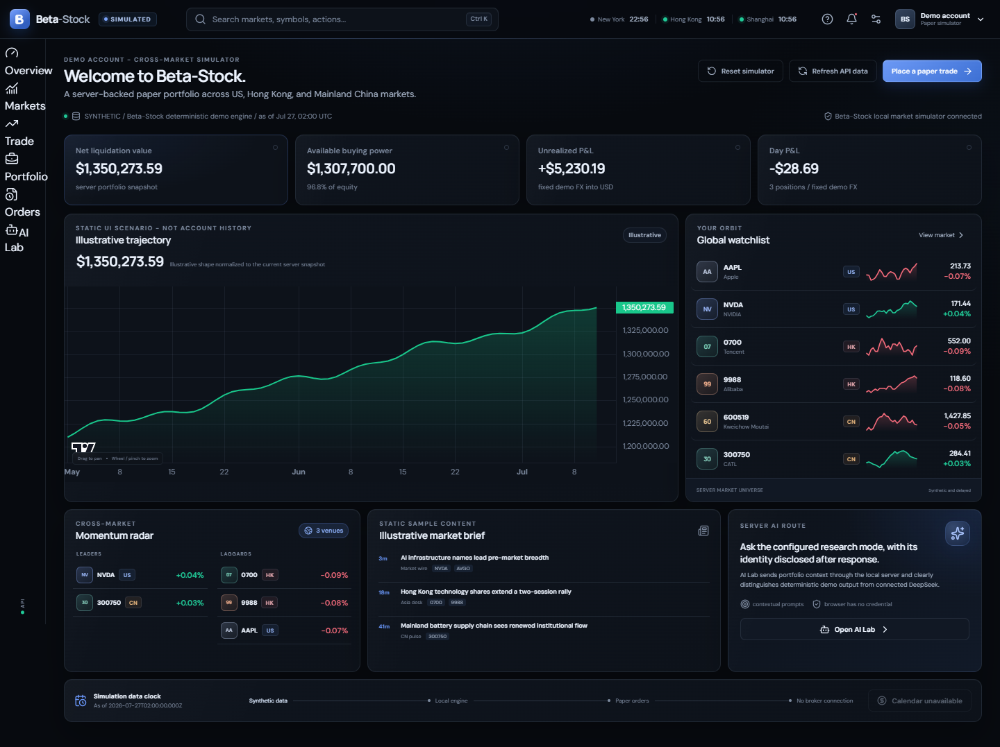
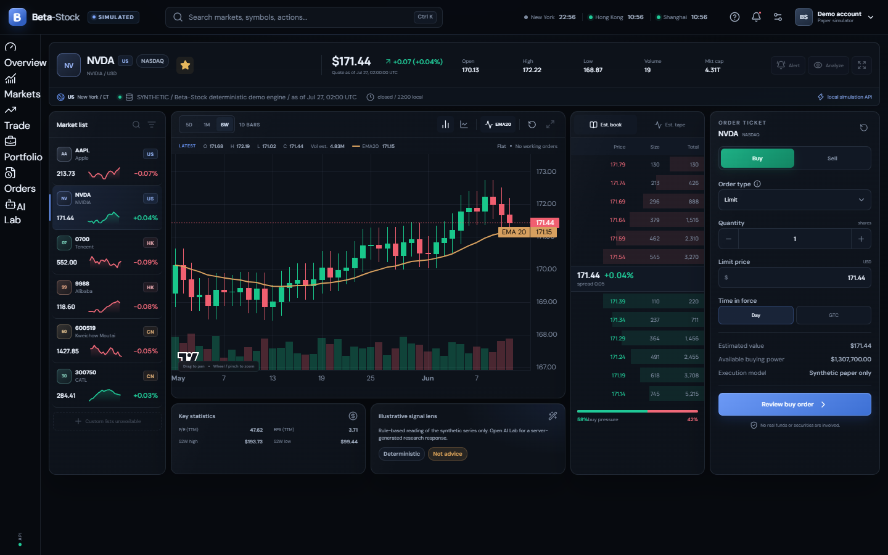
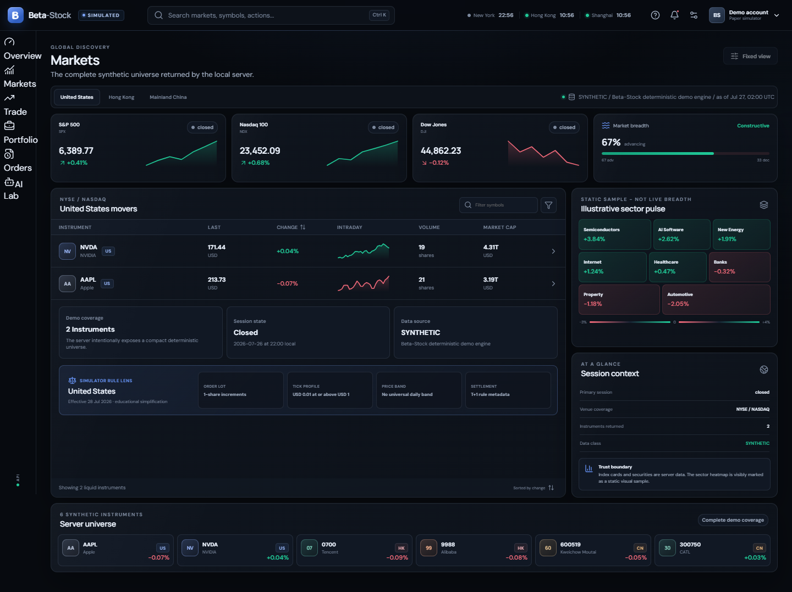
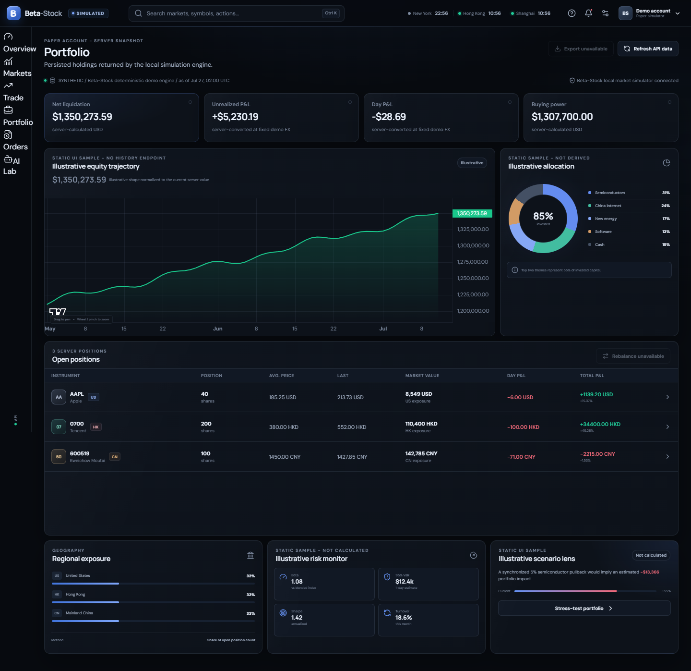
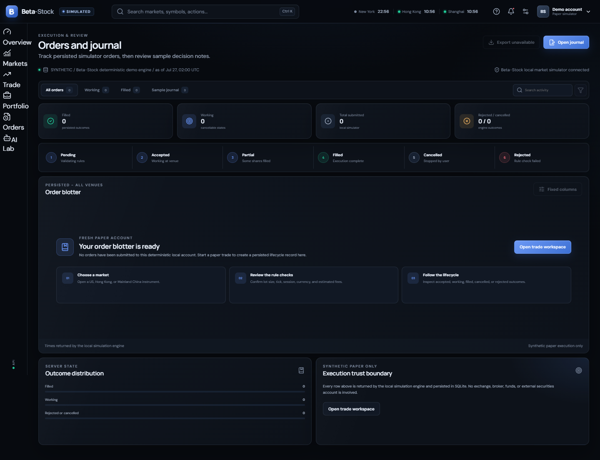
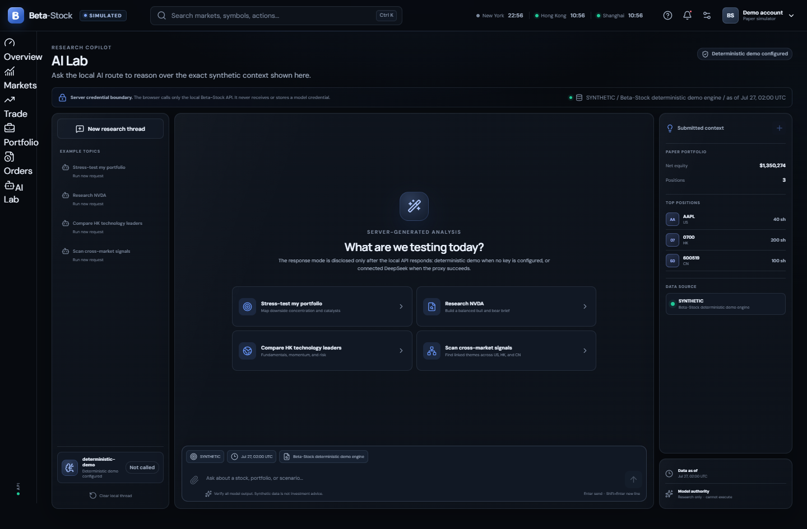
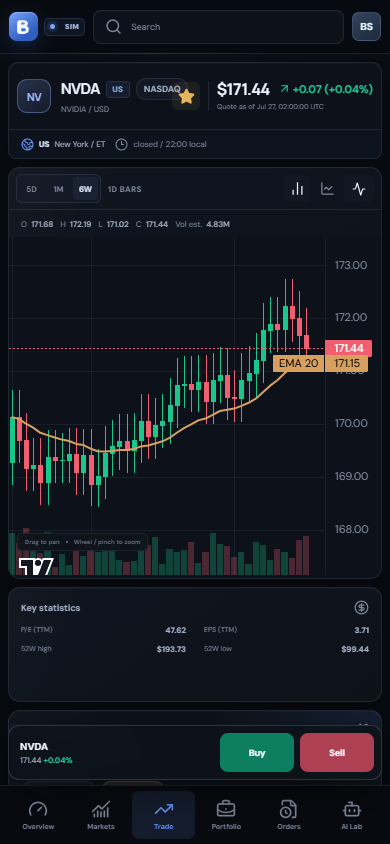
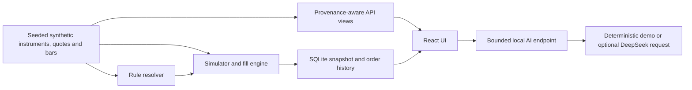

<div align="center">
  
  <h1>Beta-Stock</h1>
  <p><strong>Paper trading across three rulebooks.</strong></p>
  <p>A local-first stock simulator for US, Hong Kong, and Mainland China equities, with deterministic synthetic data and an optional server-side DeepSeek research copilot.</p>

  [](LICENSE)
  [](package.json)
  [](#data-you-can-trust)

  [Quick start](#quick-start) · [Product tour](#product-tour) · [Trust boundaries](#data-you-can-trust) · [Contribute](CONTRIBUTING.md)
</div>

---

Beta-Stock brings the structure of an active-trader terminal to a simulator that is safe to explore. It models market-specific lots and ticks, order validation, quote-liquidity-limited partial fills, fees, buying power, order events, portfolio state, T+1 A-share sell availability, and synthetic-data provenance while keeping the first screen calm and readable.

No brokerage account. No real-money routing. No fake “live” badge.

> [!IMPORTANT]
> Beta-Stock is educational simulation software, not a broker, exchange data product, or investment adviser. Default prices and fills are deterministic synthetic data. Market rules and fees can change; verify them with the linked primary sources before relying on them outside the simulator.

> [!NOTE]
> This tree is a `v0.1.0` release candidate. The dated blind visual review passed; checked-in screenshots and workflow definitions are still not proof of a tag, public CI result, clean-clone audit, or provider-side credential revocation. See the [release QA record](docs/RELEASE-QA.md) for the current evidence state.

<p align="center">
  
</p>
<p align="center"><sub>Release-candidate capture · deterministic synthetic data · no brokerage connection</sub></p>

## Quick start

Requirements: Node.js 22.12+, npm 10+, and a modern browser.

```shell
git clone https://github.com/frabcd/Beta-Stock.git
cd Beta-Stock
npm ci
npm run dev
```

Open `http://127.0.0.1:5173`. This portable path works on Windows, macOS, and Linux and keeps writable app state beneath the checkout by default. An AI key is optional; without one, AI Lab uses a clearly labeled local demonstration response.

For the one-click Windows flow, strict E:-drive storage preset, stop command, and backup caveats, see [Windows launcher and local storage](#windows-launcher-and-local-storage).

## Why Beta-Stock

Most paper-trading demos flatten every venue into the same order form. Beta-Stock treats market differences as product behavior:

- **United States:** regular-session execution, whole-share quantities, DAY/GTC orders, T+1 rule metadata, and no invented universal daily limit. Extended-hours execution and fractional orders are not modeled.
- **Hong Kong:** instrument-specific board lots, price-band ticks, midday break, a simplified closing-auction window, T+2 rule metadata, and itemized levies/fees. A cash-settlement queue is not modeled.
- **Mainland China:** call auctions, lunch break, board-aware lots and price limits, and A-share T+1 sell availability.
- **One portfolio:** USD/HKD/CNY cash buckets, positions, realized/unrealized results, and cash/share reservations.
- **One research surface:** AI Lab sends a user question plus an explicitly synthetic source/as-of and portfolio summary through the local server; it never presents the language model as a quote feed.

## Product tour

| Workspace | Designed for |
| --- | --- |
| **Overview** | Server portfolio metrics, linked synthetic watchlist, movers, and clearly labeled illustrative chart/news modules |
| **Markets** | US/HK/CN synthetic indices and instruments, session state, search/sort, plus labeled illustrative breadth/sector modules |
| **Trade** | Quote-anchored synthetic daily chart with crosshair inspection and pan/zoom/reset, estimated book/tape, illustrative statistics, and a server-validated order ticket |
| **Portfolio** | Server holdings and P&L plus clearly labeled illustrative allocation, risk, and performance modules |
| **Orders & Journal** | Persisted order status/cancellation and a non-editable sample journal |
| **AI Lab** | Streamed demo-or-DeepSeek research with the submitted synthetic context and source/as-of metadata visible |

The desktop Trade route keeps its chart, estimated book/tape, instrument context, and order ticket on one symbol. The mobile layout keeps six stable destinations and opens the trade ticket as a contextual sheet.

<table>
  <tr>
    <td width="50%"><br /><strong>Chart and order review</strong><br /><sub>Quote-aligned daily bars, explicit venue clock, currency, rules, and a separate confirmation step.</sub></td>
    <td width="50%"><br /><strong>Cross-market discovery</strong><br /><sub>US, Hong Kong, and Mainland China views with a compact deterministic universe and effective rule context.</sub></td>
  </tr>
  <tr>
    <td width="50%"><br /><strong>Portfolio state</strong><br /><sub>USD projection, native-currency positions, cash buckets, fixed demo FX, and visible illustrative boundaries.</sub></td>
    <td width="50%"><br /><strong>Persistent paper lifecycle</strong><br /><sub>Fresh-account onboarding plus accepted, working, partial, filled, cancelled, and rejected semantics.</sub></td>
  </tr>
  <tr>
    <td width="50%"><br /><strong>Research-only AI boundary</strong><br /><sub>Classification, source, exact as-of context, demo/connected identity, and no order-execution capability.</sub></td>
    <td width="50%"><br /><strong>Responsive mobile trade</strong><br /><sub>A true 390×844 viewport capture with stable navigation and an accessible contextual order sheet.</sub></td>
  </tr>
</table>

## Highlights

### A simulator that keeps receipts

- Market, limit, stop and stop-limit orders.
- DAY orders in all three markets and GTC orders in the US rule set; IOC is not implemented.
- Accepted, pending, partial, filled, cancelled, expired and rejected states.
- Deterministic submission-sequence processing limited by the bid/ask size in each supplied synthetic quote; there is no exchange price-priority, latency, slippage, queue-position, or participation model.
- Idempotent client order IDs and deterministic quote-by-quote processing.
- Exact integer/decimal arithmetic for money, fees and price validation.
- Cash/share reservation, FIFO cost basis, and lifecycle events returned with an order submission.
- Seeded synthetic fixtures and full simulator snapshot restoration. Dataset manifests and fill-model version IDs are not yet emitted.

### Cross-market fidelity without hidden magic

- Effective-dated instrument rules instead of scattered market `if` statements.
- Board/venue-aware quantity, tick, price-limit, settlement-day metadata, and fee policies.
- Exchange clocks and local session time are shown in the workspace.
- Trade and position rows label USD/HKD/CNY; the portfolio's base-equity projection uses fixed illustrative FX rates.
- Configurable green-up/red-down and red-up/green-down conventions. A blue/amber color-safe convention is not implemented.
- Compact UI display values sit on top of exact decimal/minor-unit account arithmetic.
- The trade chart supports deterministic 5D/1M/6W daily windows, candlestick/area modes, crosshair-following OHLC and estimated volume, pan/zoom gestures, and a functional reset-view control.

### DeepSeek, kept on the safe side of the boundary

- Server-only API credential; nothing secret is compiled into Vite or sent to the browser.
- Current configurable model allowlist ([`deepseek-v4-flash` and `deepseek-v4-pro`](https://api-docs.deepseek.com/quick_start/pricing)).
- Streamed answers with the UI-composed synthetic portfolio, source, and data-as-of context.
- Deterministic polished demo response when no key is configured.
- Bounded request size, history, tokens, concurrency and time.
- AI can describe a paper-trade idea in text, but it has no tool, route, or structured action that can submit or modify an order.
- No raw model reasoning, unsafe HTML, remote-image injection, or generic URL proxy.

### Built to be inspected

- React 19, TypeScript 6 and Vite 8.
- Fastify 5 loopback API with strict validation and security headers.
- Deterministic domain engine and project-contained SQLite persistence; the Windows launcher adds a strict E:-drive preset.
- Vitest unit/integration coverage and Playwright desktop/mobile flows.
- axe accessibility checks, visual captures, and workflow definitions for Windows/Linux CI, CodeQL, and secret scanning. A checked-in workflow is not a passing public run.

## Windows launcher and local storage

### One-click Windows setup

Requirements: Windows 10/11, Node.js 22.12+, npm 10+, and Microsoft Edge.

```powershell
git clone https://github.com/frabcd/Beta-Stock.git E:\Beta-Stock
Set-Location E:\Beta-Stock
powershell -ExecutionPolicy Bypass -File .\scripts\Setup-BetaStock.ps1
.\scripts\Start-BetaStock.cmd
```

The launcher builds when needed, starts the API on loopback, waits for health, and opens an Edge app window. It gives Edge an explicit profile and disk cache under `E:\Beta-Stock`; npm, app data, logs, runtime files, secrets and QA artifacts also remain inside that project. This launcher intentionally enforces the strict E:-drive privacy preset.

Stop the recorded Beta-Stock server with:

```powershell
.\scripts\Stop-BetaStock.ps1
```

The stop script verifies that the recorded process is the Node listener on `127.0.0.1:4173` before stopping it. It does not close an Edge window that is already open.

### Local files created by the Windows launcher

The strict launcher keeps its writable state beneath the checkout:

| Location | Contents |
| --- | --- |
| `E:\Beta-Stock\.data\beta-stock.sqlite` | Paper-account SQLite state; SQLite may also create matching `-wal` and `-shm` files while the server runs |
| `E:\Beta-Stock\.cache\npm` | Project-scoped npm cache |
| `E:\Beta-Stock\.cache\edge` | Dedicated Edge disk cache |
| `E:\Beta-Stock\.cache\playwright` and `.cache\xdg` | Browser-test and supporting caches when those tools run |
| `E:\Beta-Stock\.runtime\server.pid` | PID of the recorded local API process |
| `E:\Beta-Stock\.runtime\edge-profile` | Dedicated Edge user-data profile |
| `E:\Beta-Stock\.runtime\appdata` and `.runtime\temp` | Launcher-scoped application data and temporary files |
| `E:\Beta-Stock\.logs\server.stdout.log` and `.logs\server.stderr.log` | Local server output |
| `E:\Beta-Stock\.logs\build.stdout.log` and `.logs\build.stderr.log` | Launcher build output when a build is required |
| `E:\Beta-Stock\.secrets\deepseek-api-key.dpapi.xml` | Optional DPAPI-protected DeepSeek key for the current Windows account |
| `E:\Beta-Stock\artifacts` | Local QA screenshots and reports created by test/experiment commands |

These directories are local runtime material and are ignored by Git. Manual development uses the same project-relative defaults unless the documented environment variables override them; the server rejects writable paths that escape the project root.

### Reset and backup caveats

“Reset simulator” is an account reset, not a disk wipe. After confirmation, the server replaces the in-memory simulation with the deterministic seeded account and persists that replacement. Existing simulated orders, events, fills, reservations, positions, cash changes, and realized P&L are not recoverable through the app. Reset does not delete caches, the Edge profile, logs, QA artifacts, or the DPAPI secret.

`v0.1.0` has no in-app backup, export, undo, or cross-version restore workflow. For a manual filesystem backup, first run `.\scripts\Stop-BetaStock.ps1`, then copy the entire `E:\Beta-Stock\.data` directory, including any `beta-stock.sqlite-wal` and `beta-stock.sqlite-shm` files that exist. Restore only while the app is stopped, replace the directory as one set, and keep the backup with the Beta-Stock version that created it. A raw copy taken while the server is running is not a supported consistent backup.

## Development and verification

The [portable quick start](#quick-start) is the default development path on Windows, macOS, and Linux. Core writable paths remain beneath the checkout unless documented environment variables override them. `BETA_STOCK_STORAGE_POLICY=portable` is the default; the one-click Windows launcher alone sets `strict-e`.

Useful commands:

```powershell
npm run lint          # static checks
npm run typecheck     # strict TypeScript
npm run test          # simulator and API tests
npm run build         # production client
npm run test:e2e      # desktop, mobile and accessibility paths
npm run qa            # full local release gate
npm run experiments   # capture the configured visual experiment matrix
```

## Configure DeepSeek safely

The app is fully navigable without an AI key. When no key exists, AI Lab uses a clearly labeled local demonstration response.

If a key has ever been pasted into a chat, issue, log or screenshot, revoke it before doing anything else. Generate a replacement, then on Windows run:

```powershell
.\scripts\Set-DeepSeekKey.ps1
```

The script uses a masked prompt and writes a DPAPI-encrypted value to `.secrets`. The Windows launcher decrypts it in memory and passes it only to the server child process; the browser never receives it. For a disposable local development environment, `.env.example` documents the server variable, but never commit `.env`.

When connected mode is used, AI Lab sends the question and a UI-composed synthetic context summary—including portfolio equity, position symbols/share quantities, source, classification, and as-of time—to DeepSeek. Do not enter secrets or personal data. Demo mode makes no DeepSeek request. Review DeepSeek's [privacy policy](https://cdn.deepseek.com/policies/en-US/deepseek-privacy-policy.html) and [Open Platform terms](https://cdn.deepseek.com/policies/en-US/deepseek-open-platform-terms-of-service.html) before enabling the integration.

See the full [security model](docs/SECURITY.md).

## Data you can trust

DeepSeek is not a market-data provider. Beta-Stock keeps quote acquisition, simulation and AI retrieval separate.

| Label | Meaning | Default repo behavior |
| --- | --- | --- |
| `SYNTHETIC` | Seeded deterministic fixtures generated by Beta-Stock | Included and enabled |
| `REPLAY` | Reserved for imported, licensed historical events | Not implemented or emitted |
| `DELAYED` | Reserved for an entitled delayed vendor feed | No provider adapter ships |
| `LIVE` | Reserved for licensed real-time data | No provider or broker adapter ships |

The current API emits only `SYNTHETIC`. Its response envelope carries source, classification, as-of time, and computed age; quote views also expose their synthetic quote timestamp, market, currency, and session context. Vendor timestamps, entitlements, and failure semantics remain requirements for a future provider adapter, not current functionality.

Current boundaries are intentionally explicit:

- six bundled synthetic equities and fixed synthetic headline indices; no licensed quotes, news, fundamentals, FX, or exchange calendar;
- frozen scenario FX rates for the USD portfolio projection: `USD=1`, `HKD=0.1279`, and `CNY=0.1394` USD per currency unit. These are synthetic fixtures, not live or historical FX quotes;
- regular-session US execution only; no fractional/IOC orders, halts, LULD, or corporate actions;
- no cash-settlement queue, replay import, delayed/live adapter, structured AI order action, or editable journal;
- several breadth, sector, news, book/tape, statistics, allocation, performance, risk, and scenario modules are labeled illustrative UI samples;
- Node 22 currently reports the bundled `node:sqlite` API as experimental.



Provider integration is roadmap work: no replay, delayed, or live adapter interface ships today. Any future provider must document licensing, entitlement, timestamps, delay, and failure behavior; do not scrape or redistribute a source merely because a URL responds.

## Architecture at a glance

```text
src/
  app/             shell, routing, state and API client
  components/      reusable accessible UI and charts
  domain/          exact arithmetic, contracts, rules and simulator
  features/        Overview, Markets, Trade, Portfolio, Orders, AI Lab
server/
  app.ts           health, markets, account and order routes
  ai.ts            bounded demo/DeepSeek streaming route
  repository.ts    SQLite persistence
  config.ts        loopback, storage and model policy
  views.ts         response projections
scripts/           E:-scoped setup, launch, test and experiment tools
tests/             unit, integration, security, browser and visual QA
docs/              product, rules, design evidence, security and architecture
```

The production API serves the built UI from the same loopback origin. State-changing requests are origin-checked and rate-limited. The browser has no direct credential or database access.

## Visual quality and accessibility

Beta-Stock’s original graphite/arctic design aims for calm hierarchy before visual effects: crisp separators, tabular numerals, stable decimal alignment, visible data state, restrained elevation and motion that survives reduced-motion mode.

The design target covers `1920×1080`, `1440×900`, `1366×768`, `1280×720`, `700×820`, and `390×844`. The checked-in Playwright projects currently automate `1440×900`, `1366×768`, `1280×720`, and a mobile viewport, plus keyboard, reduced-motion, overflow, console, and axe checks. The dated [benchmark result](docs/DESIGN-BENCHMARK.md#dated-blind-result) records a five-from-five blind win, a 90.6/100 mapped average, and no Beta-Stock hard gate.

## Documentation

- [Product brief](docs/PRODUCT.md)
- [Architecture and API](docs/ARCHITECTURE.md)
- [Design benchmark and blind-review gate](docs/DESIGN-BENCHMARK.md)
- [Market-rule model and primary sources](docs/MARKET-RULES.md)
- [Security and privacy model](docs/SECURITY.md)
- [YouTube query and visual-analysis evidence](research/video/SEARCH_AND_VISUAL_ANALYSIS.md) — the result was a Bloomberg/Kimi news clip, not a stock-app demo; copyrighted media stays local
- [Contribution guide](CONTRIBUTING.md)
- [Security reporting](SECURITY.md)
- [Release QA record](docs/RELEASE-QA.md)
- [Ethical launch playbook](docs/LAUNCH-PLAYBOOK.md)
- [Third-party notices](THIRD_PARTY_NOTICES.md)

## Roadmap

- [x] Deterministic multi-market fixtures and account model
- [x] Rule-aware order lifecycle and provenance contract
- [ ] Complete release QA for the connected responsive workspace and server-side AI flow
- [x] E:-scoped Windows setup, data, browser profile and caches
- [ ] Licensed replay import with dataset manifests
- [ ] First licensed replay or delayed-data provider adapter
- [ ] Corporate actions and effective-dated holiday packages
- [ ] Multi-scenario accounts and shareable, secret-free replay reports
- [ ] Community rule-source review and translation packs

Roadmap checks describe the target release branch; verify the latest CI and release notes before depending on a feature.

## Contributing

Focused issues and pull requests are welcome, including reproducible bug reports, accessibility findings, documentation corrections, and primary-source market-rule updates. Market-rule changes need a primary source and an effective date. UI changes need reviewed desktop/mobile evidence. Provider changes must document licensing, entitlement, delay and failure semantics. Start with [CONTRIBUTING.md](CONTRIBUTING.md), and use [SUPPORT.md](SUPPORT.md) to choose the right channel after publication.

Please use private vulnerability reporting for security issues and never attach a real API key, account export, cookie, prompt history, or licensed dataset to a public thread.

Beta-Stock is maintained by [@frabcd](https://github.com/frabcd) with help from contributors. Roadmap items and response times are best-effort, not delivery commitments.

## License and disclaimer

Code is available under the [MIT License](LICENSE). Bundled font licenses and component notices are listed in [Third-party notices](THIRD_PARTY_NOTICES.md). Third-party services, imported datasets, exchange marks and vendor content remain subject to their own terms.

Beta-Stock is for software demonstration and education. It does not provide investment, tax, accounting or legal advice; does not guarantee market-rule completeness; and does not route real orders. Simulated performance is hypothetical and does not predict actual results.

---

<div align="center">
  Built for careful experimentation—where every fill is simulated and every data claim shows its source.
</div>
