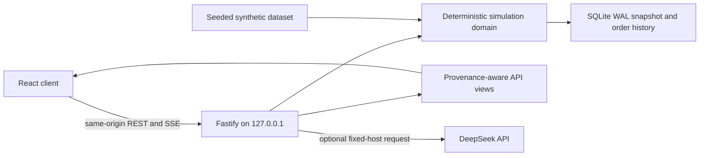

# Architecture

Beta-Stock is a single Node/TypeScript repository with three boundaries:

1. a deterministic financial domain under `src/domain`;
2. a same-origin Fastify service under `server`;
3. a React/Vite client under the remainder of `src`.

The browser renders and requests user actions. It does not own authoritative account state, credentials, matching rules or persistence.

## Runtime topology



Production serves the Vite build and `/api` from `127.0.0.1:4173`. Development runs Vite at `127.0.0.1:5173` with `/api` proxied to the same Fastify service.

## Domain

`src/domain` is browser-independent and JSON-safe:

- `contracts.ts` — instruments, quotes, bars, orders, events, fills, accounts and snapshots;
- `exact.ts` / `primitives.ts` — decimal parsing, scaled integers and exact value helpers;
- `rules.ts` — effective-dated US/HK/CN session, quantity, tick, price-limit and settlement policy;
- `fees.ts` — versioned simulator fee schedules and exact rounding;
- `validation.ts` — session/lot/tick/price-limit/risk/T+1 validation;
- `engine.ts` — reservations, lifecycle transitions, partial fills, FIFO accounting and restoration;
- `synthetic.ts` / `demo.ts` — deterministic seeded instruments, bars, quotes and account state;
- `index.ts` — the supported import surface.

Money, fees and validated prices use minor-unit strings or exact decimal helpers. Display code may convert immutable view values for chart rendering, but account mutations never depend on binary floating-point arithmetic.

The known calendar/fill boundaries are explicit: the bundled rules are weekend-aware but do not contain a maintained holiday/halt feed; extended-hours execution is not modeled; Hong Kong’s randomized closing-auction cutoff is conservatively simplified; brokerage/fee profiles are educational estimates.

## API and persistence

The server is intentionally small and auditable:

- `config.ts` — contained writable paths, loopback origins, DeepSeek allowlist and limits;
- `app.ts` — Fastify construction, security hooks and route registration;
- `repository.ts` — SQLite schema, WAL setup, snapshot persistence and order storage;
- `views.ts` — stable response shapes for markets, quotes, account and orders;
- `provenance.ts` — `SYNTHETIC` metadata and data-age headers;
- `ai.ts` — fixed-host DeepSeek/demo streaming boundary;
- `index.ts` — process startup and graceful shutdown.

The local database uses Node 22’s `node:sqlite`, WAL, foreign keys and integer minor-unit columns. Node currently labels that module experimental; the release notes must keep this visible until its stability status changes.

Portfolio views preserve local-currency minor-unit values and add USD projection fields using frozen scenario rates: `USD=1`, `HKD=0.1279`, and `CNY=0.1394` USD per currency unit. These constants are deterministic demo fixtures, not a market-data or FX service.

### API surface

| Method | Path | Purpose |
| --- | --- | --- |
| GET | `/api/health` | service, data and optional-AI status |
| GET | `/api/bootstrap` | normalized initial market/account context |
| GET | `/api/markets` | session and market summaries |
| GET | `/api/markets/equities` | instrument universe, optionally by region |
| GET | `/api/markets/indices` | synthetic headline indices |
| GET | `/api/markets/quotes/:symbol` | instrument/quote view |
| GET | `/api/markets/bars/:symbol` | deterministic chart bars (`/api/bars/:symbol` is an alias) |
| GET | `/api/snapshots[/:symbol]` | quote/instrument snapshots |
| GET | `/api/portfolio` | projected account and positions |
| GET | `/api/orders` | persisted orders and current lifecycle status |
| POST | `/api/orders` | validate and submit a paper order |
| POST | `/api/orders/:id/cancel` | cancel an eligible paper order |
| DELETE | `/api/orders/:id` | cancellation alias for an eligible paper order |
| POST | `/api/reset` | reset the deterministic scenario; the API itself has no confirmation token |
| POST | `/api/ai/chat` | bounded DeepSeek or deterministic demo stream |

Market/bootstrap views identify the deterministic source and `SYNTHETIC` classification. Order views do not carry a separate provenance field. API errors use a sanitized envelope suitable for direct user feedback.

## AI boundary

The DeepSeek endpoint is fixed to `https://api.deepseek.com/chat/completions`. The server default allowlist contains only `deepseek-v4-flash` and `deepseek-v4-pro`.

Controls include:

- explicit trusted key source (`dpapi` or opt-in `env`), with ambient keys ignored;
- model allowlist, 12,000-character history cap, body cap, token cap, timeout and rate limit;
- bounded in-process concurrency with deterministic busy response;
- `thinking: { type: "disabled" }` plus recursive removal of any `reasoning_content` in JSON or fragmented SSE;
- disconnect abort, no redirects and no generic outbound URL route;
- demo response when a key is absent;
- no order tool or direct mutation call path; the system policy also states the non-mutation boundary.

The client can ask for analysis. It appends a browser-composed synthetic context summary (source/as-of, portfolio equity, position symbols, and share quantities) to the user message. When a key is configured, the AI route forwards that content to DeepSeek as untrusted user input; it does not reconstruct authoritative portfolio state server-side. Only `POST /api/orders` can submit a paper order, and the AI route has no tool or direct call path to it.

## Client

The client provides Overview, Markets, Trade, Portfolio, Orders/Journal and AI Lab routes. TanStack Query owns server state; Zustand owns small UI preferences such as theme, gain color and mobile sheet state. Radix primitives provide dialog/menu semantics, lightweight-charts renders market series, and Framer Motion handles bounded transitions with a reduced-motion path.

Production/default mode uses `/api`. Fixture mode is an explicit development fallback selected with `VITE_DATA_MODE=fixture`; mutation controls must remain disabled there.

## Writable paths

Core development defaults to `BETA_STOCK_STORAGE_POLICY=portable` and contains writable state below the current checkout. The one-click Windows launcher is a stricter preset:

```text
E:\Beta-Stock\.data
E:\Beta-Stock\.cache
E:\Beta-Stock\.runtime
E:\Beta-Stock\.logs
E:\Beta-Stock\.secrets
E:\Beta-Stock\artifacts
```

It explicitly redirects Edge profile/cache, npm/Playwright cache, temporary directories and application-data variables to those locations. It does not change the user’s global `HOME` or npm configuration.

## Verification layers

- Unit tests: exact arithmetic, rule resolution, validation, fees, lifecycle and snapshot replay.
- Integration tests: normalized API, persistence, order accept/reject/cancel and reset.
- Security tests: path containment, origin/host handling, body limits, AI key trust, model/token/thinking/concurrency filters and reasoning removal.
- Browser tests: routes, real mutations, demo AI stream, keyboard, responsive overflow, console errors and accessibility.
- Visual review: fixed viewport captures and the blinded market-app rubric in `docs/DESIGN-BENCHMARK.md`. The checked-in dated result records the final five-surface pass; copyrighted comparison media and the hidden mapping key remain local QA evidence.
